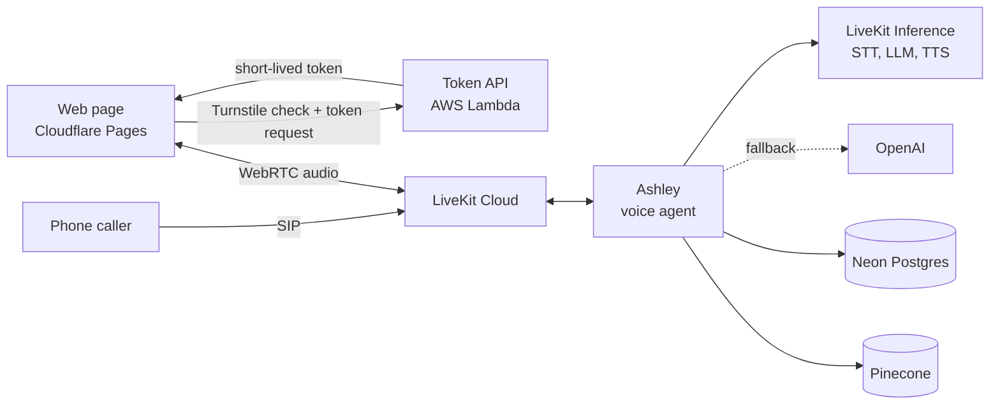
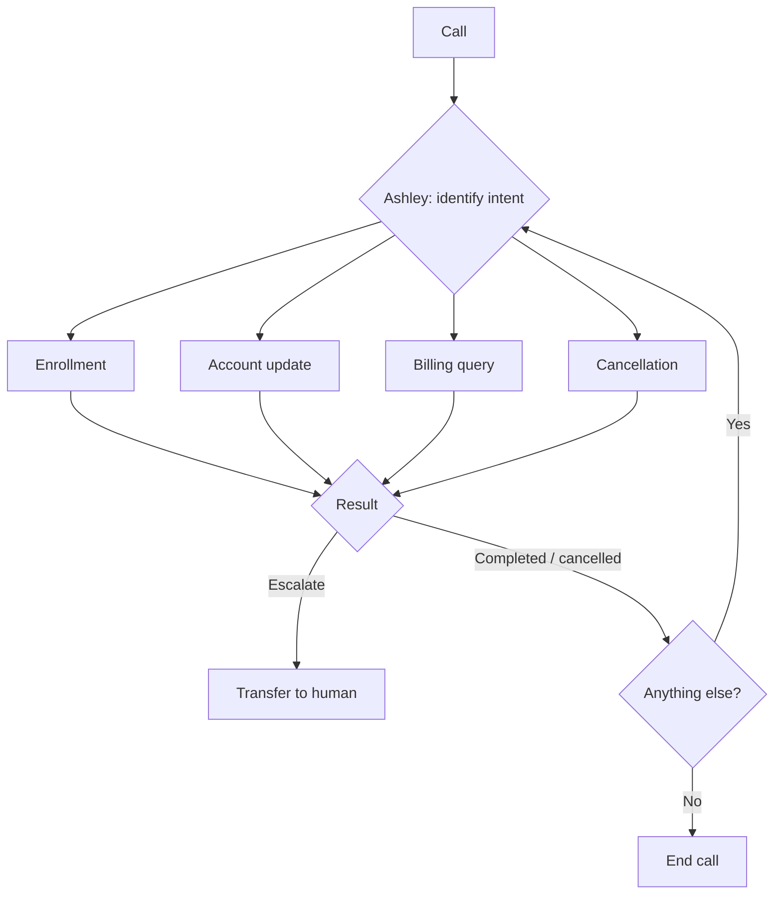

<div align="center">


# NexaConnect Voice Agent

**A real-time AI voice agent that answers customer calls and resolves the request before the call ends.**
Sign-ups, account updates, billing questions and cancellations, by phone or in the browser.

[](https://github.com/Varsha-1605/NexaConnect-Voice-Agent/actions/workflows/deploy.yml)


[Overview](#overview) · [Features](#features) · [Tech stack](#tech-stack) · [Architecture](#architecture) · [Latency](#latency) · [Testing](#testing-and-evaluation) · [Getting started](#getting-started) · [Deployment](#deployment) · [API](#api)

</div>

> [!NOTE]
> Live demo: **<https://nexaconnect-web.pages.dev>**. Click **Start session**, allow the microphone and talk to Ashley.

## Overview

NexaConnect is an internet provider whose support line handles four requests: new sign-ups, account updates, billing questions and cancellations. With human agents only, callers wait in queues, hear inconsistent answers, and routine work takes time away from harder cases.

**Ashley** answers every call immediately and completes the request during the call:

| Request | What Ashley does |
|---|---|
| **Enrollment** | Checks service at the address, answers plan questions, validates details, gets consent and saves the sign-up |
| **Account update** | Verifies the caller, validates the new plan, phone, email or address, confirms and saves |
| **Billing query** | Verifies the caller, explains the bill, checks payment status, resolves it or opens a support ticket |
| **Cancellation** | Verifies the caller, records the reason, offers an alternative, explains contract terms, confirms and submits |

Each completed request returns a reference number. The caller can start another request in the same call, and Ashley transfers phone callers to a person when needed.

> **Ashley:** Hi, I'm Ashley from NexaConnect. How can I help?
>
> **Customer:** I'd like to sign up for internet at my new place in Austin.
>
> **Ashley:** Great, let me check service at that address first. What's the street address?
>
> *Ashley confirms coverage, answers plan questions, collects and checks the details, reads back a summary and asks for consent.*
>
> **Ashley:** You're all set. Your enrollment reference is E, N, R, then the date, then a short code. Is there anything else I can help with?

## Features

- **Phone and browser calls:** callers reach Ashley over a phone number (SIP) or the web page, and she transfers phone callers to a human agent when needed
- **Real-time voice pipeline:** noise cancellation, VAD, streaming STT, semantic turn detection, interruption handling, preemptive generation and streaming TTS
- **Supervisor agent pattern:** one agent owns the call and delegates each request to a specialist task with its own tools and a typed result
- **Grounded answers (RAG):** prices, plans and policies come only from the company FAQ via Pinecone vector search
- **Customer verification:** identity checks before account access, with attempt limits and a 24-hour lockout
- **Safe writes:** explicit consent, idempotency keys, an audit trail, and success reported only after the save
- **Provider fallbacks and timeouts:** backup STT, LLM and TTS providers; slow dependencies degrade to a clear spoken message
- **Security:** short-lived scoped tokens, bot protection (Cloudflare Turnstile), CORS and CSP, role-based access control and least privilege
- **Rate limiting:** capped call length, token API concurrency and request size, and database connections per call
- **Horizontal scaling:** stateless workers, pooled database connections, serverless token API and CDN-hosted web page
- **Low latency:** about 1 s from the caller finishing to Ashley speaking (see [Latency](#latency))
- **Observability:** structured events, per-turn latency, usage per call, call replay in LiveKit Agent Insights, PII masked in logs
- **CI/CD:** unit tests on every push; per-component deploys behind a manual approval

## Tech stack

| Area | Technology |
|---|---|
| **Frameworks** | LiveKit Agents, LangChain, pytest, pytest-asyncio, LiveKit JS client SDK |
| **LLM** | Gemma 4 31B (LiveKit Inference), OpenAI GPT-4.1 mini (fallback) |
| **STT** | Deepgram Nova-3, AssemblyAI (fallback) |
| **TTS** | Cartesia Sonic 3, Deepgram Aura 2 (fallback) |
| **Database** | Neon PostgreSQL, Pinecone (vector) |
| **Observability and monitoring** | LiveKit Agent Insights, AWS CloudWatch |
| **Testing** | pytest |
| **Evaluation and simulation** | LiveKit simulations |
| **Deployment** | Docker, LiveKit Cloud, AWS Lambda, Cloudflare Pages |
| **CI/CD** | GitHub Actions |
| **Cloud platforms** | LiveKit Cloud, AWS, Cloudflare, Neon, Pinecone |

## Architecture



### Agent design

The four requests are alternatives within one conversation, each with a strict procedure, so the agent uses LiveKit's [supervisor pattern](https://docs.livekit.io/agents/logic/patterns/supervisor/). Ashley (`PrimaryAgent`) greets, routes and stays in control. Each request runs as an `AgentTask` with only the tools it needs and returns **completed**, **cancelled by customer** or **escalate**. Verification status is shared across tasks, so a caller is verified only once per call.



A single agent holding every tool tends to mix up procedures, and handoffs leave no agent owning the call. With the supervisor pattern, a new request type needs only a prompt, a task and a delegation tool.

### Phone calls and human transfer

Phone callers reach the agent through a LiveKit SIP trunk, and their calls run through the same pipeline and workflows as browser sessions. When a caller asks for a person, or a task returns **escalate**, Ashley tells the caller she is transferring them, then transfers the call to `HUMAN_TRANSFER_NUMBER` over SIP.

> [!IMPORTANT]
> Transfer works only on phone calls. In the browser or console, Ashley tells the caller she can't transfer them.

## Latency

A pause of a second already feels long on a phone call, so the whole response path is tuned for speed:

- The VAD model, turn detector, LLM clients and vector index are loaded when the worker starts, before the first call
- A keep-alive ping keeps the Pinecone connection warm, which avoids a 1 to 2.5 s reconnect mid-call
- Embeddings for common questions are precomputed, and new query embeddings are cached in memory
- The database and knowledge base connect in parallel at call start
- Preemptive generation starts the reply before the turn is fully confirmed, and Ashley says "one moment" only when a lookup takes more than 1.2 s

In live calls on LiveKit Cloud, the median time from the caller stopping to Ashley speaking is 0.8 to 1.1 s. Model timings:

| Metric | p50 | p95 |
|---|---|---|
| LLM time to first token (Gemma 4 31B) | 237 ms | 821 ms |
| TTS time to first byte (Cartesia Sonic 3) | 150 ms | 334 ms |

## Testing and evaluation

| Suite | Size | What it covers |
|---|---|---|
| Unit (`tests/unit`) | 137 tests | Validation, address matching, reference spelling, PII masking, FAQ chunking, time zones, token API |
| Agent (`tests/agent`) | 32 tests | Tool rules (no write without consent, no account data before verification, attempt limits) and LLM-judged conversations (routing, grounded answers, no prompt leaks) |
| Integration (`tests/integration`) | 29 tests | Duplicates, concurrent writes, lockouts, audit records and least-privilege permissions on a Neon test branch |
| Retrieval (`tests/retrieval`) | 30 questions | Each customer phrasing must return the correct FAQ entry in the top 3 (recall ≥ 95%) |
| Simulated calls (`simulations/`) | 16 scenarios | An AI caller on LiveKit tests enrollment, billing, failed verification, refused consent, prompt injection and requests for a person |

Simulated calls run against an in-memory backend, so they never touch real data. Six `critical` scenarios must pass before a deploy. The seven in `to_fix.yaml` still fail and are being fixed.

```bash
uv run pytest tests/unit
uv run pytest tests/agent
uv run pytest tests/integration
uv run pytest tests/retrieval
uv run python simulations/run.py critical
```

> [!NOTE]
> The agent conversation tests need `LIVEKIT_API_KEY` and `LIVEKIT_API_SECRET`, and the retrieval suite needs `OPENAI_API_KEY` and `PINECONE_API_KEY`. The integration suite needs the Neon test branch (`TEST_DATABASE_URL`, `TEST_ADMIN_DATABASE_URL`).

## Getting started

### Prerequisites

- Python 3.13 and [uv](https://docs.astral.sh/uv/)
- A [LiveKit Cloud](https://cloud.livekit.io/) project
- OpenAI and Pinecone API keys, and a [Neon](https://neon.tech/) PostgreSQL database

### Run locally

```bash
git clone https://github.com/Varsha-1605/NexaConnect-Voice-Agent.git
cd NexaConnect-Voice-Agent

cp .env.example .env                                  # add your keys
uv sync
uv run agent.py download-files                        # VAD and turn-detector models

uv run python -m db.setup                             # tables
uv run python -m db.create_app_user                   # least-privilege role
uv run python -m kb.ingest --namespace production     # FAQ into Pinecone
```

Start the agent and the web page in two terminals, then open http://localhost:8080 and click **Start session**:

```bash
uv run python agent.py dev
uv run python web/server.py
```

> [!WARNING]
> `web/server.py` issues tokens without the Turnstile check and listens only on localhost. Use it for local development only; production tokens come from the Lambda token API.

### Console mode

Talk to Ashley in the terminal, without the web page:

```bash
uv run agent.py console
```

> [!TIP]
> Use headphones in console mode, otherwise the microphone picks up Ashley's voice and she interrupts herself.

### Sample billing data

To test billing queries, add a bill to an existing enrollment. The scenario can be `normal`, `high`, `unpaid` or `pending`:

```bash
uv run python -m db.seed_billing <enrollment-reference> unpaid
```

### Phone calls

Create an inbound SIP trunk in LiveKit Cloud with a dispatch rule for the agent name (`nexaconnect-ashley`), and set `HUMAN_TRANSFER_NUMBER` to enable transfers.

### Configuration

All settings are in [`.env.example`](.env.example):

| Setting | Purpose |
|---|---|
| `LIVEKIT_URL`, `LIVEKIT_API_KEY`, `LIVEKIT_API_SECRET` | LiveKit Cloud project |
| `OPENAI_API_KEY` | Fallback LLM and knowledge base embeddings |
| `PINECONE_API_KEY`, `PINECONE_INDEX_NAME`, `PINECONE_NAMESPACE` | Knowledge base index (`nexaconnect-kb`, namespace `production` by default) |
| `DATABASE_URL` | Limited `app_user` role used by the agent |
| `ADMIN_DATABASE_URL` | Owner role, used only by `db.setup` and `db.create_app_user` |
| `TEST_DATABASE_URL`, `TEST_ADMIN_DATABASE_URL` | Same roles on the Neon test branch |
| `HUMAN_TRANSFER_NUMBER` | E.164 number for transfers on phone calls |
| `AGENT_NAME` | Dispatch name (default `nexaconnect-ashley`) |
| `BUSINESS_TIMEZONE` | Business time zone for dates (default `America/New_York`) |

> [!IMPORTANT]
> Never point `DATABASE_URL` at the owner role. The agent is meant to run as `app_user`, which can't delete rows or change tables. Rotate its password with `uv run python -m db.create_app_user --rotate`.

## Deployment

| Component | Platform | How |
|---|---|---|
| Voice agent | LiveKit Cloud | Docker image, `lk agent deploy` |
| Token API | AWS Lambda | `token_api/handler.py`, zipped and uploaded by the pipeline |
| Web page | Cloudflare Pages | `web/`, deployed with Wrangler |

Every push and pull request runs the unit tests in [`deploy.yml`](.github/workflows/deploy.yml). On `main`, path filters deploy only the components that changed, each after manual approval on the `production` environment. The token API deploy ends with a smoke test, and the agent deploy with `lk agent status`.

The Docker image is a multi-stage `uv` build that runs as a non-root user, with the VAD and turn-detector models built in. Workers shut down gracefully on `SIGTERM`, so a deploy doesn't cut off active calls.

Required GitHub configuration on the `production` environment:

- **Secrets:** `LIVEKIT_URL`, `LIVEKIT_API_KEY`, `LIVEKIT_API_SECRET`, `AWS_ACCESS_KEY_ID`, `AWS_SECRET_ACCESS_KEY`, `CLOUDFLARE_ACCOUNT_ID`, `CLOUDFLARE_API_TOKEN`
- **Variables:** `LAMBDA_FUNCTION_NAME`, `TOKEN_API_URL`, `TURNSTILE_SITE_KEY`

The Lambda function itself needs `LIVEKIT_URL`, `LIVEKIT_API_KEY`, `LIVEKIT_API_SECRET`, `AGENT_NAME`, `TURNSTILE_SECRET` and `ALLOWED_ORIGIN`.

> [!CAUTION]
> Give the AWS deploy user only `lambda:UpdateFunctionCode` and `lambda:GetFunction` on the token function. Agent secrets live in LiveKit Cloud, never in the repository.

## API

The web page gets a LiveKit access token from the token API before joining a call.

| Endpoint | Purpose |
|---|---|
| `POST /api/token` | Send `{"turnstile": "<token>"}`; receive `{"url", "token"}` for one new room, valid for 10 minutes |

```bash
curl -X POST "$TOKEN_API_URL/api/token" \
  -H "Content-Type: application/json" \
  -H "Origin: https://nexaconnect-web.pages.dev" \
  -d '{"turnstile": "<turnstile-response-token>"}'
```

| Status | Meaning |
|---|---|
| `200` | Token issued |
| `400` | Missing Turnstile token |
| `403` | Turnstile check failed, or origin not allowed |
| `413` | Request body over 4 KB |
| `503` | Turnstile unreachable; the request is refused, never let through |

## Project structure

```
.
├── agent.py              # Ashley (supervisor), session setup, transfer, call limits
├── config.py             # models, timings and limits
├── voice_models.py       # STT, LLM and TTS with fallbacks
├── workflows/            # specialist tasks (AgentTask) and shared tools
├── services/             # business logic and knowledge base search
├── prompts/              # system prompts for Ashley and each task
├── db/                   # schema, connection pool, setup and least-privilege role
├── kb/                   # FAQ ingestion into Pinecone
├── data/                 # company FAQ (knowledge base source)
├── token_api/            # AWS Lambda token API
├── web/                  # call page and local token server
├── simulations/          # AI-simulated call scenarios
├── tests/                # unit, agent, integration and retrieval tests
├── Dockerfile
└── .github/workflows/    # CI/CD pipeline
```
