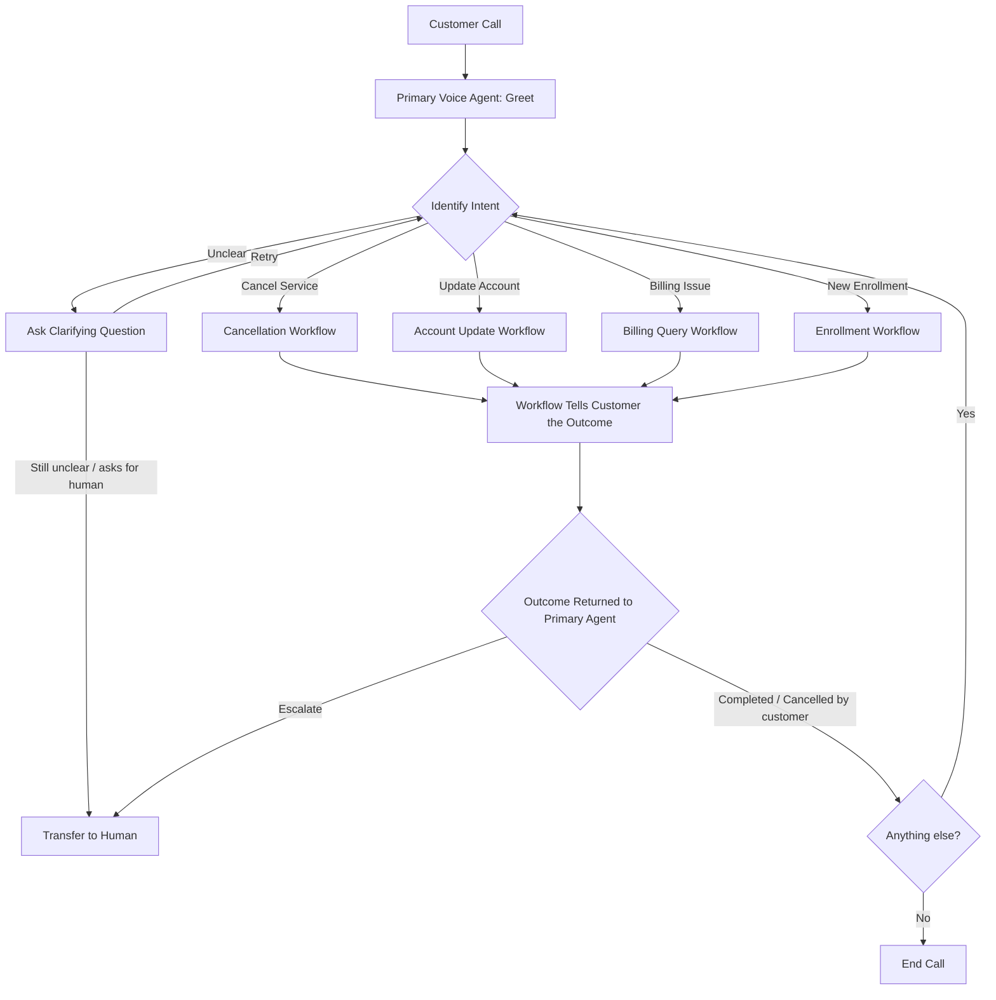

<div align="center">


# NexaConnect Voice Agent

> Ashley answers NexaConnect's customer calls: sign-ups, cancellations, account changes and billing questions.

[About](#about-nexaconnect) · [How it works](#how-it-works) · [Getting started](#getting-started) · [Run it](#run-it) · [Project structure](#project-structure)
</div>

## About NexaConnect

NexaConnect is an internet provider company. It sells home internet to households and looks after those customers afterwards.

| Plan | Download | Upload | Price |
|---|---|---|---|
| Home 300 | up to 300 Mbps | 30 Mbps | $40 / month |
| Home 500 | up to 500 Mbps | 50 Mbps | $55 / month |
| Home Gigabit | up to 1,000 Mbps | 100 Mbps | $75 / month |

Availability and current offers depend on the customer's address.

## Problem

Customers call NexaConnect to sign up for internet, cancel it, change their account details or ask about a bill. Handling every call by hand means long waits, answers that differ from one agent to the next, and slow resolution.

## Solution

A voice assistant named Ashley answers every call. She works out what the customer needs and moves them to a workflow built for that request. Each workflow follows the same steps every time, tells the customer the outcome, and hands the call back to Ashley. Anything she can't resolve goes to a person.

Ashley can:

- Sign up new customers: check service at their address, answer plan questions and save the enrollment
- Cancel a service: offer an alternative plan, explain contract terms and the end date
- Update account details, after verifying who is calling
- Explain a bill, check payment status and open a support ticket if needed
- Transfer the call to a human when asked, or when a request can't be resolved

### Example call

> **Ashley:** Hi, I'm Ashley from NexaConnect. How can I help?
>
> **Customer:** I'd like to cancel my internet.
>
> **Ashley:** I'm sorry to hear that. First I need to verify your account. Could I have your name, service address, and the email or phone number on the account?
>
> *Ashley verifies the customer, asks why they are leaving, offers an alternative plan, explains the contract terms and end date, and asks for confirmation.*
>
> **Ashley:** Your cancellation is submitted. Your reference is C, A, N, then the date, then a short code. Is there anything else I can help with?

## How it works

Built on [LiveKit Agents](https://docs.livekit.io/agents/) using the supervisor pattern: one primary agent talks to the customer and delegates each request to a workflow.



The primary agent greets the customer, works out what they need (asking a clarifying question if unclear), routes to a workflow, and asks "anything else?" when it returns. It also owns `transfer_to_human`. Each workflow returns one of three results:

- **completed**: the task finished (this includes creating a support ticket, or telling the customer service isn't available)
- **cancelled by customer**: the customer stopped before it finished
- **escalate**: the customer needs a human, so the primary agent transfers the call

### Workflows

| Workflow | What it does | Tools |
|---|---|---|
| Enrollment | Confirms whether the customer wants to check availability or sign up, checks service at their address, answers plan questions from the knowledge base, validates their details, gets consent and saves the enrollment | `get_current_date`, `check_service_availability`, `search_knowledge_base`, `validate_customer_details`, `submit_enrollment` |
| Cancellation | Verifies the customer, captures the reason, offers an alternative plan, explains contract terms and the end date, confirms and submits | `verify_customer`, `get_account_details`, `search_knowledge_base`, `get_contract_terms`, `submit_cancellation`, `get_cancellation_status` |
| Account update | Identifies the change, verifies the customer, collects and validates the new value, confirms and updates | `verify_customer`, `get_account_details`, `search_knowledge_base`, `validate_account_change`, `update_customer_details` |
| Billing query | Verifies the customer, explains the bill, checks payment status, then resolves it or creates a support ticket | `verify_customer`, `get_bill_details`, `get_payment_status`, `create_support_ticket` |

Rules that apply to every call:

- The customer is verified before any tool that reads or changes account data. Verification carries over between workflows, so nobody is verified twice.
- Enrollment is for new customers, so it validates details instead of verifying an account.
- Workflows never transfer calls themselves; they return **escalate** and the primary agent does it.
- Each enrollment, cancellation or ticket gets a reference number. Ashley reads it out letter by letter and the web page shows it in a card with a Copy button.

### Tech stack

| Part | Technology |
|---|---|
| Voice pipeline | LiveKit Agents, Deepgram STT, Gemma LLM, Cartesia TTS (via LiveKit Inference) |
| Knowledge base (plans and FAQs) | LangChain, OpenAI embeddings, Pinecone |
| Customer, enrollment and billing data | PostgreSQL (Neon) with asyncpg |
| Browser frontend | aiohttp token server and a static page using `livekit-client` |
| Phone calls and transfer | LiveKit SIP (Telnyx is the planned phone provider) |

## Getting started

### Prerequisites

- [uv](https://docs.astral.sh/uv/) and Python 3.13
- A [LiveKit Cloud](https://cloud.livekit.io/) project
- An OpenAI API key, a Pinecone API key and a PostgreSQL database (for example Neon)

### Setup

1. Install dependencies and download the turn-detector and VAD models:

   ```bash
   uv sync
   uv run agent.py download-files
   ```

2. Create a `.env` file in the project root:

   ```
   LIVEKIT_URL=
   LIVEKIT_API_KEY=
   LIVEKIT_API_SECRET=
   OPENAI_API_KEY=
   PINECONE_API_KEY=
   DATABASE_URL=            # the limited app_user (created by `python -m db.create_app_user`)
   ADMIN_DATABASE_URL=      # the Neon owner string; only for db.setup and db.create_app_user
   TEST_DATABASE_URL=       # app_user on the Neon test branch (integration tests)
   TEST_ADMIN_DATABASE_URL= # owner string of the test branch
   HUMAN_TRANSFER_NUMBER=   # E.164, e.g. +15551234567; only used on phone calls
   PINECONE_INDEX_NAME=     # optional, defaults to nexaconnect-kb
   PINECONE_NAMESPACE=      # production (default) or test
   AGENT_NAME=              # nexaconnect-ashley (default); use nexaconnect-ashley-test for a local test worker
   BUSINESS_TIMEZONE=       # optional, defaults to America/New_York
   # All other settings (timeouts, model names, limits) are constants in config.py.
   ```

3. Create the database tables and build the knowledge base:

   ```bash
   uv run python -m db.setup
   uv run python -m kb.ingest --namespace production
   uv run python -m kb.ingest --namespace test
   ```

## Run it

**In the browser** (two terminals):

```bash
uv run python agent.py dev
uv run python web/server.py
```

Open <http://localhost:8080> and click **Start session**.

**In the terminal:**

```bash
uv run agent.py console
```

> [!TIP]
> Use headphones in console mode, otherwise the microphone picks up the agent's voice and it interrupts itself.

> [!NOTE]
> `transfer_to_human` only works on real phone calls (SIP). In the browser or console the agent says it can't transfer.

To create a bill for an enrollment: `uv run python -m db.seed_billing <enrollment_reference> normal|high|unpaid|pending`.

## Project structure

```
agent.py        Entry point: primary agent, call transfer, silence check-in
utils.py        Prompt loading and reference helpers
workflows/      One workflow per request type, plus shared tools
services/       Business logic: accounts, billing, enrollment, knowledge base
db/             Connection pool, schema and setup
kb/             Builds the Pinecone index from data/
data/           FAQ source for the knowledge base
prompts/        System prompts for the primary agent and each workflow
docs/           Workflow specs and architecture notes
web/            Browser frontend
```

## Tests

```bash
uv run pytest tests/unit tests/agent/test_enrollment_tools.py tests/agent/test_verification_tools.py   # fast, no network
uv run pytest tests/agent/test_conversation.py   # talks to the real model (needs LiveKit credentials in .env)
uv run python -m kb.ingest --namespace test && uv run pytest tests/retrieval   # search quality, needs Pinecone + OpenAI keys
```
